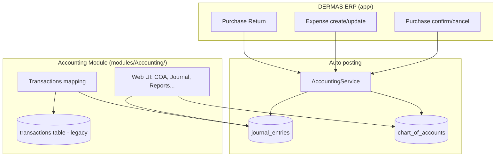
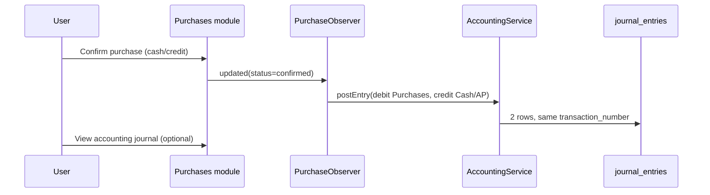

# DERMAS ERP — Accounting Module Full Guide

> **Purpose:** This document explains the Accounting module end-to-end: navigation, buttons, sections, URLs, data flow, and how it connects to the main ERP. Use it for onboarding, support, or as context for AI assistants integrating with this codebase.

**Base URL example:** `https://erp.dermasapparel.com`  
**Module prefix:** `/accounting/...` and `/report/accounting/...`

---

## 1. Overview

The Accounting module is a **Laravel nwidart-style module** at `modules/Accounting/`. It provides:

- Chart of Accounts (COA)
- Journal entries (double-entry bookkeeping)
- Bank reconciliation
- Budgeting
- Financial reports (P&L, balance sheet, ageing, etc.)
- Transaction mapping UI (legacy Ultimate POS `transactions` table)

The main DERMAS ERP **also posts journal entries automatically** when certain ERP records change (purchases, expenses, purchase returns) via `App\Services\AccountingService` and model observers — **independent of** the Transactions mapping screens.

### Architecture diagram



---

## 2. Access & permissions

| Item | Detail |
|------|--------|
| Sidebar link | ERP layout → **Accounting** (requires `accounting.view`) |
| Permission | `config/permissions.php` → `accounting.view` |
| Middleware | `accounting.session` on all `/accounting/*` and `/report/accounting/*` routes |
| Session defaults | `AccountingSessionDefaults` sets `business.id = 1` and `user.business_id = 1` if missing (Ultimate POS compatibility) |

**Route registration:** `modules/Accounting/Providers/AccountingServiceProvider.php` loads `modules/Accounting/Http/routes.php`.

---

## 3. Top navigation bar (every accounting page)

File: `modules/Accounting/Resources/views/layouts/nav.blade.php`

| Button | URL | What it does |
|--------|-----|----------------|
| **Accounting** (dashboard) | `/accounting/dashboard` | Summary charts, account balances by type |
| **Chart of Accounts** | `/accounting/chart_of_account` | List/create/edit GL accounts |
| **Journal of Entries** | `/accounting/journal_entry` | List/create/edit/reverse manual journal entries |
| **Transfers** | `/accounting/transfers` | Move money between accounts |
| **Transactions** | `/accounting/transactions/sales?type=payment` | Map legacy POS transactions to COA |
| **Reconcile** | `/accounting/reconcile` | Bank/account reconciliation |
| **Budgeting** | `/accounting/budget?view=monthly&year={FY}` | Monthly/quarterly/yearly budgets |
| **Reports** | `/report/accounting` | Report hub (cards by section) |
| **Settings** | `/accounting/settings/account_subtypes` | Account subtypes & detail types |

---

## 4. Section-by-section guide

### 4.1 Dashboard — `/accounting/dashboard`

**Controller:** `DashboardController@index`

**What you see:**
- Balance summary by account type (asset, liability, equity, income, expense)
- Expense chart, financial year charts, last 30 days chart

**Actions:**
- Mostly read-only charts
- AJAX: `GET /accounting/dashboard/get_totals` for totals

---

### 4.2 Chart of Accounts — `/accounting/chart_of_account`

**Controller:** `ChartOfAccountController`

| Action | Method | URL | Result |
|--------|--------|-----|--------|
| List / tree view | GET | `/accounting/chart_of_account` | All accounts with balances |
| AJAX list | GET | `/accounting/chart_of_account/get_chart_of_accounts` | DataTables JSON |
| Create | GET | `/accounting/chart_of_account/create` | Form |
| Save new | POST | `/accounting/chart_of_account/store` | Inserts account |
| View | GET | `/accounting/chart_of_account/{id}/show` | Account detail + entries |
| Edit | GET | `/accounting/chart_of_account/{id}/edit` | Edit form |
| Update | POST | `/accounting/chart_of_account/{id}/update` | Saves changes |
| Delete | GET | `/accounting/chart_of_account/{id}/destroy` | Deactivates/removes |
| Export | GET | `/accounting/chart_of_account/export` | PDF/Excel export |

**Account fields (typical):** `gl_code`, `name`, `account_type`, `account_subtype_id`, `detail_type_id`, `parent_id`, `active`, `allow_manual`.

**Seeded GL codes** (`database/seeders/ChartOfAccountsSeeder.php`):

| GL Code | Name | Type |
|---------|------|------|
| 1000 | Cash | asset |
| 1010 | Bank Account | asset |
| 1200 | Accounts Receivable | asset |
| 1300 | Inventory | asset |
| 2000 | Accounts Payable | liability |
| 4000 | Sales Revenue | income |
| 5100 | Purchases | expense |
| 6000 | General & Administrative Expense | expense |
| 6900 | Other Expense | expense |

---

### 4.3 Journal Entries — `/accounting/journal_entry`

**Controller:** `JournalEntryController`

Manual double-entry transactions. Each logical transaction has a shared `transaction_number` with **two rows**: one debit, one credit.

| Action | URL |
|--------|-----|
| List (filters: date, location, account, search) | GET `/accounting/journal_entry` |
| AJAX list | GET `/accounting/journal_entry/get_journal_entries` |
| Create | GET `/accounting/journal_entry/create` |
| Save | POST `/accounting/journal_entry/store` |
| View | GET `/accounting/journal_entry/{id}/show` |
| Edit | GET `/accounting/journal_entry/{id}/edit` |
| Update | POST `/accounting/journal_entry/{id}/update` |
| **Reverse** | GET `/accounting/journal_entry/{id}/reverse` |
| Delete | GET `/accounting/journal_entry/{id}/destroy` |

**Reverse:** Marks entries `reversed = 1` (void), does not delete rows.

---

### 4.4 Transfers — `/accounting/transfers`

**Controller:** `AccountingController`

| Action | URL |
|--------|-----|
| List | GET `/accounting/transfers` |
| Create form | GET `/accounting/transfers/create` |
| Save transfer | POST `/accounting/transfers/store` |

Moves value between two chart-of-account balances (e.g. Cash → Bank).

---

### 4.5 Transactions (ERP ledger) — `/accounting/transactions/*`

**Controller:** `AccountingTransactionController`  
**View:** `transactions/erp_ledger.blade.php` (tabs)

| Tab | URL | Journal `transaction_type` filter |
|-----|-----|-----------------------------------|
| Sales | `/accounting/transactions/sales` | `sale`, `sale_cogs`, `customer_payment`, `customer_refund`, `sale_return`, `sale_return_cogs`, `cheque_receipt`, `cheque_clearance` |
| Purchases | `/accounting/transactions/purchases` | `purchase`, `purchase_payment`, `purchase_return`, `supplier_refund` |
| Expenses | `/accounting/transactions/expenses` | `expense`, `sales_person_expense`, `vehicle_run_expense`, `payroll_accrual`, `payroll_payment` |
| Inventory | `/accounting/transactions/inventory` | `manufacturing_*`, `material_inventory_adjustment`, `finished_goods_adjustment` |

**Important:** This UI reads **`journal_entries`** auto-posted from ERP (via `AccountingService::postOnce`). Legacy Ultimate POS `transactions` mapping is disabled (`map_to_chart_of_account` → 410). Full unfiltered books remain under **Journal Entries**.

**Filters:** entry type, date range, search (txn # / name / reference).

---

### 4.6 Reconcile — `/accounting/reconcile`

**Controller:** `ReconcileController`

| Step | Action | URL |
|------|--------|-----|
| 1 | Choose account, opening/ending balance, ending date | GET `/accounting/reconcile` |
| 2 | Start reconcile (compute difference) | POST `/accounting/reconcile/start` |
| 3 | Complete reconcile | POST `/accounting/reconcile/store` |
| 4 | Undo last reconcile | POST `/accounting/reconcile/undo` |

Compares statement ending balance vs sum of journal entries on that account.

---

### 4.7 Budget — `/accounting/budget`

**Controller:** `BudgetController`

| View | URL param |
|------|-----------|
| Monthly | `?view=monthly&year=YYYY` |
| Quarterly | `?view=quarterly&year=YYYY` |
| Yearly | `?view=yearly&year=YYYY` |

| Action | URL |
|--------|-----|
| Update monthly amounts | POST `/accounting/budget/update_monthly_budget` |
| Update quarterly | POST `/accounting/budget/update_quarterly_budget` |
| Update yearly | POST `/accounting/budget/update_yearly_budget` |
| Set financial year start | POST `/accounting/budget/store_financial_year_start` |

---

### 4.8 Reports hub — `/report/accounting`

**Controller:** `ReportController@index`  
**Service:** `AccountingReportService::getReports()`

Five sections with clickable cards:

#### A. Business Overview
| Report | URL |
|--------|-----|
| Balance Sheet | `/report/accounting/balance_sheet` |
| Statement of Cash Flows | `/report/accounting/cash_flow` |
| Profit and Loss | `/report/accounting/profit_and_loss` |

#### B. Bookkeeping
| Report | URL |
|--------|-----|
| Trial Balance | `/report/accounting/trial_balance` |
| General Ledger | `/report/accounting/ledger` |
| Journal | `/report/accounting/journal` |

#### C. Budget
| Report | URL |
|--------|-----|
| Budget Overview | `/report/accounting/budget_overview?view=monthly&year={FY}` |

#### D. Who owes you (Receivables)
| Report | URL |
|--------|-----|
| A/R Ageing Summary | `/report/accounting/accounts_receivable_ageing_summary` |
| A/R Ageing Detail | `/report/accounting/accounts_receivable_ageing_detail` |

#### E. What you owe (Payables)
| Report | URL |
|--------|-----|
| A/P Ageing Summary | `/report/accounting/accounts_payable_ageing_summary` |
| A/P Ageing Detail | `/report/accounting/accounts_payable_ageing_detail` |

**Common report UI pattern:**
1. Filter form: `start_date`, `end_date`, `location_id`
2. **Submit** → refreshes table
3. **Clear** → resets filters
4. **Download** → `?download=1&type=pdf` or Excel

Duplicate shortcuts (same reports): `/accounting/trial_balance`, `/accounting/ledger`, etc. (older routes in `routes.php`).

---

### 4.9 Settings — `/accounting/settings/*`

**Layout:** sidebar with two tabs

| Section | URL | Actions |
|---------|-----|---------|
| Account Subtypes | `/accounting/settings/account_subtypes` | Add (POST store), Edit, Update, Delete |
| Detail Types | `/accounting/settings/detail_types` | Add, Edit, Update, Delete |

Subtypes group accounts (e.g. "Cash and Cash Equivalents"). Detail types are finer classification under subtypes.

---

### 4.10 Module install (first-time)

| URL | Purpose |
|-----|---------|
| GET `/accounting/install` | Install wizard |
| POST `/accounting/install` | Run migrations/seed for module |
| GET `/accounting/install/update` | Module update |
| GET `/accounting/install/uninstall` | Uninstall |

Usually run once; production uses deploy migrate + `ChartOfAccountsSeeder`.

---

## 5. ERP integration — automatic journal posting

**Service:** `app/Services/AccountingService.php`

Posts **balanced pairs** to `journal_entries`:
- Row 1: `debit = amount`, `credit = 0`
- Row 2: `debit = 0`, `credit = amount`
- Same `transaction_number` (e.g. `TXN-XXXXXXXX`)

### 5.1 Purchase confirmed

**Observer:** `app/Observers/PurchaseObserver.php`  
**Trigger:** `purchases.status` → `confirmed`

| | Debit | Credit |
|---|-------|--------|
| Confirm | Raw materials (1310) | Accounts Payable (2000) |
| Header / row payment | Accounts Payable (2000) | Cash (1000) or Bank (1010) |

**Cancel:** Reverses entry. **Update while confirmed:** Replaces entry with new total.

### 5.2 Expense created/updated

**Observer:** `app/Observers/ExpenseObserver.php`

| | Debit | Credit |
|---|-------|--------|
| Expenses | 6000 / 6100 / 6200 / 6300 / 6900 (category match) | Cash / Bank |

Also: `SalesPersonExpenseObserver`, `VehicleDailyRunItemObserver`, payroll observers.

### 5.3 Purchase return

**Service:** `app/Services/PurchaseReturnService.php`

Debits AP and credits raw materials for confirmed returns (`purchase_return`).

### 5.4 What IS auto-posted (current code)

| Area | Trigger | Types |
|------|---------|-------|
| Orders / POS sales | `OrderObserver` → `SalesAccountingService` when status `completed` / `paid` / `credit` | `sale`, `sale_cogs` |
| Customer payments / refunds | `PaymentObserver` | `customer_payment`, `customer_refund` |
| Cheques | `ChequePaymentLifecycleService` | `cheque_receipt`, `cheque_clearance` |
| Sale returns | `SaleReturnObserver` (confirmed) | `sale_return`, `sale_return_cogs` |
| Purchases / payments / returns | Purchase observers + `PurchaseReturnService` | `purchase`, `purchase_payment`, `purchase_return`, `supplier_refund` |
| Expenses / field / vehicle / payroll | Expense + SPE + vehicle + payroll observers | `expense`, `sales_person_expense`, `vehicle_run_expense`, `payroll_*` |
| Inventory / manufacturing | `InventoryAccountingService` + material/stock/mfg observers | `manufacturing_*`, stock adjustments |

**Not posted until recognition:** wholesale/POS orders still in `pending` / `processing` / `afterchecking` (sale/COGS wait until invoice completes the order).

**Backfill:** `php artisan accounting:backfill --force` or `/deploy/{key}/accounting-repair` (also seeds Chart of Accounts).

---

## 6. Core database tables

| Table | Role |
|-------|------|
| `chart_of_accounts` | GL accounts |
| `journal_entries` | All debit/credit lines |
| `account_subtypes` | Classification under account types |
| `account_detail_types` | Finer classification |
| `payment_details` | Payment metadata linked to some entries |
| `transactions` | Legacy POS transactions (mapping UI) |
| `budgets` | Budget amounts by period |
| `purchases.accounting_txn_number` | Link to auto-posted purchase JE |
| `expenses.accounting_txn_number` | Link to auto-posted expense JE |

Migrations: `modules/Accounting/Database/Migrations/`

---

## 7. User journey examples

### Journey A: New purchase (ERP → books)



### Journey B: Manual adjustment

1. Go **Journal of Entries** → **Create**
2. Enter date, accounts, debit/credit amounts, memo
3. **Save** → new `transaction_number` in `journal_entries`
4. Verify in **Reports → General Ledger**

### Journey C: Month-end reports

1. **Reports** → **Trial Balance** → set date range → Submit
2. **Profit and Loss** for same period
3. **Balance Sheet** as at end date

---

## 8. Key files reference (for developers / AI)

| Area | Path |
|------|------|
| Routes | `modules/Accounting/Http/routes.php` |
| Top nav | `modules/Accounting/Resources/views/layouts/nav.blade.php` |
| Auto GL posting | `app/Services/AccountingService.php` |
| Purchase hook | `app/Observers/PurchaseObserver.php` |
| Expense hook | `app/Observers/ExpenseObserver.php` |
| COA seed | `database/seeders/ChartOfAccountsSeeder.php` |
| Session middleware | `app/Http/Middleware/AccountingSessionDefaults.php` |
| ERP sidebar link | `resources/views/erp/layout.blade.php` (search `accounting.view`) |
| Module manifest | `modules/Accounting/module.json` |
| Report list | `modules/Accounting/Services/AccountingReportService.php` |

---

## 9. Deploy & prerequisites

1. Run migrations: `/deploy/{DEPLOY_KEY}/migrate`
2. Seed chart of accounts (included in `ResetDatabaseSeeder` / `DatabaseSeeder`)
3. User role must have `accounting.view`
4. After `.env` DB change: `/deploy/{DEPLOY_KEY}/config-clear`

---

## 10. Troubleshooting

| Problem | Likely cause | Fix |
|---------|--------------|-----|
| Accounting menu hidden | No permission | Grant `accounting.view` on role |
| Purchase confirmed but no JE | COA not seeded | Run `ChartOfAccountsSeeder` |
| Reports empty | No journal entries in date range | Confirm purchases/expenses or post manual JE |
| 404 on `/deploy/...` | Wrong key or old routes | Upload `routes/web.php` + `routes/deploy.php` |
| DB connection error | `DB_HOST=127.0.0.1` on cPanel | Use `localhost` or updated `config/database.php` |
| Transactions screen empty | No rows in `transactions` table | Normal if only using DERMAS purchases (use ERP reports instead) |

---

## 11. Quick URL cheat sheet

Replace `{key}` with `DEPLOY_KEY` from `.env` (default `dermas-2026`).

```
/accounting/dashboard
/accounting/chart_of_account
/accounting/journal_entry
/accounting/transfers
/accounting/transactions/sales?type=payment
/accounting/transactions/expenses
/accounting/transactions/purchases?type=purchase_payment
/accounting/reconcile
/accounting/budget?view=monthly&year=2026
/report/accounting
/report/accounting/profit_and_loss
/accounting/settings/account_subtypes
/deploy/{key}/migrate
/deploy/{key}/reset-db          ← DANGER: wipes data
```

---

*Document version: 2026-05-26 — DERMAS ERP codebase.*
